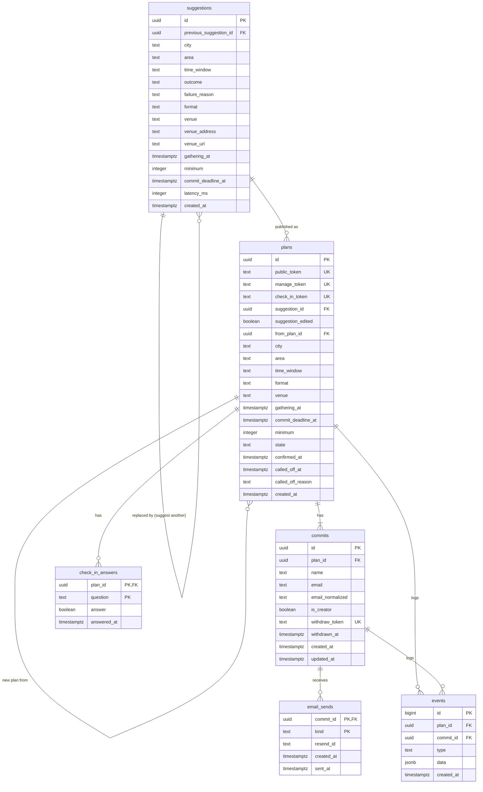

# Database Schema: calvin

**Version**: 1.0
**Database**: Postgres on Neon (Free plan, `aws-us-west-2`), Postgres 17 (Neon default)
**ORM**: Drizzle ORM 0.45.4 + `pg` 8.23.1; migrations by drizzle-kit 0.31.11
**Maturity**: poc
**Last Updated**: 2026-10-27
**Inputs**: [PRD.md](./PRD.md), [architecture.md](./architecture.md), [ux-spec.md](./ux-spec.md), [GLOSSARY.md](../../GLOSSARY.md), ADRs [0002](../../docs/adr/0002-postgres-owns-state-temporal-owns-time.md), [0004](../../docs/adr/0004-suggestions-sonnet-web-search.md), [0005](../../docs/adr/0005-capability-tokens-stored-in-plaintext.md)

---

## Overview

Six tables. `plans` and `commits` hold the state that Postgres owns (ADR 0002). `email_sends` is the send ledger that makes every email go out once (NFR008). `check_in_answers` holds the creator's "Did it happen?" answers. `suggestions` records every suggestion request, and `events` is the append-only log of plan lifecycle changes. Together they give the operator the trial metrics by SQL (FR029).

Nothing is deleted by the app: no soft deletes, no delete routes. A **withdraw** is `commits.withdrawn_at`, and a **called off** plan is a state. Foreign keys cascade from `plans` so the operator can remove a test plan with one `DELETE FROM plans WHERE id = …`.

**Change from the architecture outline**: suggestions get their own `suggestions` table (operator decision in this stage) instead of `suggestion.requested` events with `plan_id null`. A plan links its suggestion through `plans.suggestion_id`. So `events.plan_id` is never null, and the `suggestion.requested` event type is dropped. The architecture's "record a `suggestion.requested` event with `outcome: "failed"`" becomes "insert a `suggestions` row with `outcome = 'failed'`".

### Conventions

| Element | Convention | Example |
|---------|------------|---------|
| Table names | Plural, snake_case | `plans`, `email_sends` |
| Column names | snake_case; instants end in `_at` | `commit_deadline_at`, `withdrawn_at` |
| Drizzle fields | camelCase, mapped to snake_case with `casing: 'snake_case'` | `commitDeadlineAt` |
| Primary keys | `id UUID DEFAULT gen_random_uuid()` (native in Postgres 13+, no extension); `events.id` is a `BIGINT` identity so the log has a total order | |
| Foreign keys | `{singular}_id` | `plan_id`, `commit_id` |
| Times | `TIMESTAMP WITH TIME ZONE`, always UTC instants. Local-time rules live in `src/domain/time.ts` | |
| Text | `TEXT` + `CHECK (char_length(...) BETWEEN …)`, not `VARCHAR(n)` | |
| Enums | `TEXT` + `CHECK (col IN (...))`, not Postgres `ENUM` (simpler to extend in a migration) | |
| Constraint names | `{table}_{what}_check`, `{table}_{cols}_key`, `idx_{table}_{cols}` | `plans_state_check` |
| Soft deletes | None | |
| `updated_at` | Only on `commits`, the only row whose fields are overwritten (FR013). Set by Drizzle `$onUpdate`, no triggers | |

### Text limits

These are the database's backstop. The zod schemas in `src/web/forms.ts` enforce the same limits and show inline errors first.

| Field | Limit | Why |
|-------|-------|-----|
| `city` | 1–60 | One of `CITIES`; longest is 13 chars |
| `area`, `time_window` | 1–200 | Free-text creator inputs |
| `format` | 1–40 | "Coffee", "A walk around Lake Merritt" |
| `venue` | 1–120 | Venue name, as shown in the h1 |
| `venue_address` | 1–200 | Suggestion only |
| `venue_url` | 1–2048 | Suggestion only |
| `name` | 1–80 | Architecture validation pattern |
| `email` | 3–254 | RFC 5321 path limit |
| Tokens | exactly 43, `[A-Za-z0-9_-]` | `randomBytes(32).toString('base64url')` (256 bits, NFR005) |

---

## Entity Relationship Diagram



---

## Tables

### suggestions

**Purpose**: one row per suggestion request (`POST /suggest`), successful or not (FR002–FR004, FR029). A **suggestion** isn't a plan; a plan that was published from one points at it.

| Column | Type | Null | Default | Description |
|--------|------|------|---------|-------------|
| id | UUID | NOT NULL | `gen_random_uuid()` | PK. Carried in the create form as hidden field `suggestionId` |
| previous_suggestion_id | UUID | NULL | — | FK → `suggestions(id)` ON DELETE SET NULL. Set when the request is "Suggest another" (or "Try suggesting again"), from the form's current `suggestionId` |
| city | TEXT | NOT NULL | — | Creator input |
| area | TEXT | NOT NULL | — | Creator input ("rough area") |
| time_window | TEXT | NOT NULL | — | Creator input ("rough time") |
| outcome | TEXT | NOT NULL | — | `'ok'` or `'failed'` |
| failure_reason | TEXT | NULL | — | Set only when failed: `'timeout'`, `'api_error'`, `'no_proposal'`, `'pause_turn'`, `'refusal'`, `'max_tokens'`, `'invalid_proposal'` (a `propose_plan` input that fails the app's range checks) |
| format | TEXT | NULL | — | `propose_plan` format. Set iff ok |
| venue | TEXT | NULL | — | Venue name. Set iff ok |
| venue_address | TEXT | NULL | — | Street address from `propose_plan`, if given. Not copied to the plan |
| venue_url | TEXT | NULL | — | Source URL from `propose_plan` / web search citation, if given. Not copied to the plan |
| gathering_at | TIMESTAMPTZ | NULL | — | Proposed date and time, as a UTC instant. Set iff ok |
| minimum | INTEGER | NULL | — | Proposed minimum (≥ 2). Set iff ok |
| commit_deadline_at | TIMESTAMPTZ | NULL | — | The default deadline shown on the card (FR007, computed at suggest time). Set iff ok |
| latency_ms | INTEGER | NOT NULL | — | Wall time of the Anthropic call, for NFR001 |
| created_at | TIMESTAMPTZ | NOT NULL | `now()` | |

**Constraints**:
```sql
CHECK (char_length(city) BETWEEN 1 AND 60)
CHECK (char_length(area) BETWEEN 1 AND 200)
CHECK (char_length(time_window) BETWEEN 1 AND 200)
CHECK (outcome IN ('ok', 'failed'))
CHECK ((outcome = 'failed') = (failure_reason IS NOT NULL))
CHECK (failure_reason IN ('timeout', 'api_error', 'no_proposal', 'pause_turn', 'refusal', 'max_tokens', 'invalid_proposal'))
CHECK (outcome = 'failed' OR (format IS NOT NULL AND venue IS NOT NULL AND gathering_at IS NOT NULL
                               AND minimum IS NOT NULL AND commit_deadline_at IS NOT NULL))
CHECK (char_length(format) BETWEEN 1 AND 40)
CHECK (char_length(venue) BETWEEN 1 AND 120)
CHECK (char_length(venue_address) BETWEEN 1 AND 200)
CHECK (char_length(venue_url) BETWEEN 1 AND 2048)
CHECK (minimum >= 2)
CHECK (latency_ms >= 0)
```

(A `CHECK` on a NULL column passes, so the length checks only bite when a value is present.)

A proposal that would break a check (empty venue, minimum 1) is recorded as `failed` / `invalid_proposal`, with the proposed fields left null, and the creator sees the fallback.

---

### plans

**Purpose**: a published **plan**: its fields, its capability tokens and its state. Fields never change after insert (FR010); only `state`, `confirmed_at`, `called_off_at` and `called_off_reason` do, and only in `src/domain/plans.ts` under a row lock (ADR 0002).

| Column | Type | Null | Default | Description |
|--------|------|------|---------|-------------|
| id | UUID | NOT NULL | `gen_random_uuid()` | PK. Internal: logs and workflow ID `plan-<id>`, never in a URL |
| public_token | TEXT | NOT NULL | — | UNIQUE. `/p/:token` |
| manage_token | TEXT | NOT NULL | — | UNIQUE. `/m/:token` |
| check_in_token | TEXT | NOT NULL | — | UNIQUE. `/c/:token/:question/:answer` |
| suggestion_id | UUID | NULL | — | FK → `suggestions(id)` ON DELETE SET NULL. The `ok` suggestion the creator published from. Null for a fallback (hand-filled) plan and for a new plan started from another plan |
| suggestion_edited | BOOLEAN | NULL | — | Null iff no suggestion. Otherwise true if any of `format`, `venue`, `gathering_at`, `minimum`, `commit_deadline_at` differs from the suggestion (format and venue compared after trimming) (FR029) |
| from_plan_id | UUID | NULL | — | FK → `plans(id)` ON DELETE SET NULL. The plan this was started from (FR025) |
| city | TEXT | NOT NULL | — | One of `CITIES` (validated in the app, not in SQL) |
| area | TEXT | NOT NULL | — | Creator input; copied for a new plan from a plan |
| time_window | TEXT | NOT NULL | — | Creator input; copied for a new plan from a plan |
| format | TEXT | NOT NULL | — | Eyebrow on the plan card |
| venue | TEXT | NOT NULL | — | Venue name, the h1 |
| gathering_at | TIMESTAMPTZ | NOT NULL | — | Start of the **gathering** |
| commit_deadline_at | TIMESTAMPTZ | NOT NULL | — | The **commit deadline** |
| minimum | INTEGER | NOT NULL | — | The **minimum**, counting the creator |
| state | TEXT | NOT NULL | `'open'` | `'open'`, `'confirmed'`, `'called_off'` |
| confirmed_at | TIMESTAMPTZ | NULL | — | When it was **confirmed**. Kept if later called off |
| called_off_at | TIMESTAMPTZ | NULL | — | When it was **called off** |
| called_off_reason | TEXT | NULL | — | `'deadline'` (FR022) or `'creator'` (FR023) |
| created_at | TIMESTAMPTZ | NOT NULL | `now()` | Published at |

**Constraints**:
```sql
CHECK (public_token   ~ '^[A-Za-z0-9_-]{43}$')
CHECK (manage_token   ~ '^[A-Za-z0-9_-]{43}$')
CHECK (check_in_token ~ '^[A-Za-z0-9_-]{43}$')
CHECK (char_length(city) BETWEEN 1 AND 60)
CHECK (char_length(area) BETWEEN 1 AND 200)
CHECK (char_length(time_window) BETWEEN 1 AND 200)
CHECK (char_length(format) BETWEEN 1 AND 40)
CHECK (char_length(venue) BETWEEN 1 AND 120)
CHECK (minimum >= 2)
CHECK (commit_deadline_at < gathering_at)
CHECK (state IN ('open', 'confirmed', 'called_off'))
CHECK (called_off_reason IN ('deadline', 'creator'))
-- state and its timestamps move together
CHECK (
     (state = 'open'       AND confirmed_at IS NULL     AND called_off_at IS NULL     AND called_off_reason IS NULL)
  OR (state = 'confirmed'  AND confirmed_at IS NOT NULL AND called_off_at IS NULL     AND called_off_reason IS NULL)
  OR (state = 'called_off' AND called_off_at IS NOT NULL AND called_off_reason IS NOT NULL
      AND (called_off_reason = 'creator' OR confirmed_at IS NULL))
)
```

The last clause encodes "a confirmed plan is only ever called off by the creator": a deadline call-off can't happen to a confirmed plan. "Deadline in the future at publish" depends on the clock, so the app checks it (FR007), not SQL.

Tokens are stored as plaintext, because emails are rebuilt from stored data on every retry ([ADR 0005](../../docs/adr/0005-capability-tokens-stored-in-plaintext.md)).

---

### commits

**Purpose**: one row per person per plan: a **commit**, with the email it's deduplicated on (FR012–FR017). The creator's commit is the first row (FR008).

| Column | Type | Null | Default | Description |
|--------|------|------|---------|-------------|
| id | UUID | NOT NULL | `gen_random_uuid()` | PK |
| plan_id | UUID | NOT NULL | — | FK → `plans(id)` ON DELETE CASCADE |
| name | TEXT | NOT NULL | — | Trimmed. Overwritten by a repeat commit (FR013). Pages show the first word, capped at 16 chars |
| email | TEXT | NOT NULL | — | Trimmed, as last typed. Never rendered on any page (NFR006) |
| email_normalized | TEXT | NOT NULL | — | `lower(email)`. The dedupe key |
| is_creator | BOOLEAN | NOT NULL | `false` | True for exactly one commit per plan |
| withdraw_token | TEXT | NOT NULL | — | UNIQUE. `/w/:token`. Generated for every commit; the withdraw route refuses `is_creator` (FR017) and the creator's emails carry no withdraw link |
| withdrawn_at | TIMESTAMPTZ | NULL | — | Set by **withdraw**; cleared by committing again with the same email |
| created_at | TIMESTAMPTZ | NOT NULL | `now()` | First commit |
| updated_at | TIMESTAMPTZ | NOT NULL | `now()` | Drizzle `$onUpdate(() => new Date())` |

**Constraints and indexes**:
```sql
UNIQUE (plan_id, email_normalized)                                   -- FR013 upsert target
CREATE UNIQUE INDEX commits_one_creator_per_plan ON commits (plan_id) WHERE is_creator;
CHECK (char_length(name) BETWEEN 1 AND 80)
CHECK (char_length(email) BETWEEN 3 AND 254)
CHECK (email_normalized = lower(email))
CHECK (withdraw_token ~ '^[A-Za-z0-9_-]{43}$')
CHECK (NOT (is_creator AND withdrawn_at IS NOT NULL))               -- FR017
```

**Active commit and count**: a commit is active when `withdrawn_at IS NULL`. A plan's **count** is its number of active commits:

```sql
SELECT count(*) FROM commits WHERE plan_id = $1 AND withdrawn_at IS NULL;
```

**Commit upsert** (inside the transaction that holds `SELECT … FROM plans WHERE id = $1 FOR UPDATE`):

```sql
INSERT INTO commits (plan_id, name, email, email_normalized, withdraw_token)
VALUES ($1, $2, $3, lower($3), $4)
ON CONFLICT (plan_id, email_normalized)
DO UPDATE SET name = excluded.name, email = excluded.email, withdrawn_at = NULL, updated_at = now()
RETURNING id, (xmax = 0) AS inserted;
```

`inserted` tells a new commit from a repeat. The conflict path keeps the existing `withdraw_token` (it isn't in the `SET` list), so links already emailed keep working. In Drizzle: `.onConflictDoUpdate({ target: [commits.planId, commits.emailNormalized], set: { name, email, withdrawnAt: null } })` with `.returning({ id: commits.id, inserted: sql<boolean>\`(xmax = 0)\` })`.

A committer who withdraws and commits again keeps their `email_sends` rows, so they don't get a second confirmation email. That's intended: NFR008 counts per committer and plan.

---

### email_sends

**Purpose**: the send ledger. One row per email per committer, so each email goes out once (NFR008, ADR 0002).

| Column | Type | Null | Default | Description |
|--------|------|------|---------|-------------|
| commit_id | UUID | NOT NULL | — | PK part. FK → `commits(id)` ON DELETE CASCADE. The recipient |
| kind | TEXT | NOT NULL | — | PK part. Email kind (below) |
| resend_id | TEXT | NULL | — | Resend's email id, once sent |
| created_at | TIMESTAMPTZ | NOT NULL | `now()` | Ledger row written (send started) |
| sent_at | TIMESTAMPTZ | NULL | — | Resend accepted it. Null = not yet sent, or sending failed and will be retried |

**Primary key**: `(commit_id, kind)`.

**Constraints**:
```sql
CHECK (kind IN ('manage_link', 'confirmed', 'reminder_24h', 'reminder_morning', 'not_this_time', 'check_in'))
CHECK ((sent_at IS NULL) = (resend_id IS NULL))
CHECK (char_length(resend_id) BETWEEN 1 AND 100)
```

`manage_link` and `check_in` go only to the creator's commit; the app enforces that (it's a cross-table rule). The plan id is reached through `commits.plan_id`.

**`sendOnce(kind, plan, commit)`**:
```sql
INSERT INTO email_sends (commit_id, kind) VALUES ($1, $2) ON CONFLICT DO NOTHING;
SELECT sent_at FROM email_sends WHERE commit_id = $1 AND kind = $2;   -- return if not null
-- Resend send, idempotencyKey = '<kind>/<planId>/<commitId>'
UPDATE email_sends SET sent_at = now(), resend_id = $3 WHERE commit_id = $1 AND kind = $2;
INSERT INTO events (plan_id, commit_id, type, data) VALUES ($4, $1, 'email.sent', ...);
```
The last two statements run in one transaction.

**The 24h reminder's actual send time** (for FR021's 6h rule) is `max(sent_at)` of the plan's `reminder_24h` rows. The workflow also records it (architecture), so this query is a fallback, not the rule.

---

### check_in_answers

**Purpose**: the creator's latest answer to each **check-in** question (FR027–FR028). Every answer, including replaced ones, is also in `events` as `check_in.answered`.

| Column | Type | Null | Default | Description |
|--------|------|------|---------|-------------|
| plan_id | UUID | NOT NULL | — | PK part. FK → `plans(id)` ON DELETE CASCADE |
| question | TEXT | NOT NULL | — | PK part. `'happened'` ("Did it happen?") or `'attended'` ("Were you there?") |
| answer | BOOLEAN | NOT NULL | — | yes = true |
| answered_at | TIMESTAMPTZ | NOT NULL | `now()` | Latest answer |

**Primary key**: `(plan_id, question)`.

```sql
CHECK (question IN ('happened', 'attended'))
```

**Record an answer** (FR028, answering again replaces):
```sql
INSERT INTO check_in_answers (plan_id, question, answer) VALUES ($1, $2, $3)
ON CONFLICT (plan_id, question) DO UPDATE SET answer = excluded.answer, answered_at = now();
```

The route accepts answers only for a plan whose state is `confirmed` (called-off plans get no check-in, FR027).

---

### events

**Purpose**: append-only log of every plan lifecycle change and email sent, each with a timestamp (FR029). Never updated or deleted by the app. Written in the same transaction as the change it records.

| Column | Type | Null | Default | Description |
|--------|------|------|---------|-------------|
| id | BIGINT | NOT NULL | `GENERATED ALWAYS AS IDENTITY` | PK. Total order of the log |
| plan_id | UUID | NOT NULL | — | FK → `plans(id)` ON DELETE CASCADE |
| commit_id | UUID | NULL | — | FK → `commits(id)` ON DELETE CASCADE. Set for `commit.*` and `email.sent` |
| type | TEXT | NOT NULL | — | Event type (below) |
| data | JSONB | NOT NULL | `'{}'` | Per-type payload (see JSON Column Schemas) |
| created_at | TIMESTAMPTZ | NOT NULL | `now()` | |

**Constraints**:
```sql
CHECK (type IN ('plan.published', 'commit.added', 'commit.withdrawn', 'plan.confirmed',
                'plan.called_off', 'email.sent', 'check_in.answered'))
CHECK ((type IN ('commit.added', 'commit.withdrawn', 'email.sent')) = (commit_id IS NOT NULL))
CHECK (jsonb_typeof(data) = 'object')
```

| Type | Written by | commit_id |
|------|------------|-----------|
| `plan.published` | publish (FR008–FR009, FR025) | — |
| `commit.added` | publish (the creator) and every commit, new or repeat (FR012–FR013) | the commit |
| `commit.withdrawn` | withdraw (FR016) | the commit |
| `plan.confirmed` | commit that reaches the minimum (FR018) | — |
| `plan.called_off` | `resolveDeadline` (FR022) or call-off (FR023) | — |
| `email.sent` | `sendOnce`, every kind | the recipient |
| `check_in.answered` | check-in route (FR028), every answer | — |

No row is written for a refused commit or call-off: the request changed nothing.

---

## Relationships

### One-to-Many

| Parent | Child | FK column | On delete | Index |
|--------|-------|-----------|-----------|-------|
| suggestions | suggestions | previous_suggestion_id | SET NULL | `idx_suggestions_previous_suggestion_id` |
| suggestions | plans | suggestion_id | SET NULL | `idx_plans_suggestion_id` |
| plans | plans | from_plan_id | SET NULL | `idx_plans_from_plan_id` |
| plans | commits | plan_id | CASCADE | `commits_plan_id_email_normalized_key` (leading column) |
| plans | check_in_answers | plan_id | CASCADE | PK (leading column) |
| plans | events | plan_id | CASCADE | `idx_events_plan_id_created_at` |
| commits | email_sends | commit_id | CASCADE | PK (leading column) |
| commits | events | commit_id | CASCADE | `idx_events_commit_id` |

ON UPDATE is the default (NO ACTION) everywhere: primary keys never change.

No many-to-many relationships.

---

## Indexes

### Primary and unique

| Table | Index | Columns | Purpose |
|-------|-------|---------|---------|
| suggestions | `suggestions_pkey` | id | |
| plans | `plans_pkey` | id | Activities, workflow |
| plans | `plans_public_token_key` | public_token | `/p/:token` lookup |
| plans | `plans_manage_token_key` | manage_token | `/m/:token` lookup |
| plans | `plans_check_in_token_key` | check_in_token | `/c/:token/...` lookup |
| commits | `commits_pkey` | id | |
| commits | `commits_withdraw_token_key` | withdraw_token | `/w/:token` lookup |
| commits | `commits_plan_id_email_normalized_key` | (plan_id, email_normalized) | FR013 upsert; also the plan's commits list and count |
| commits | `commits_one_creator_per_plan` | plan_id WHERE is_creator | One creator per plan; finds the creator for `manage_link`/`check_in` |
| email_sends | `email_sends_pkey` | (commit_id, kind) | Ledger key |
| check_in_answers | `check_in_answers_pkey` | (plan_id, question) | Upsert key |
| events | `events_pkey` | id | |

### Foreign key and query

| Table | Index | Columns | Purpose |
|-------|-------|---------|---------|
| suggestions | `idx_suggestions_previous_suggestion_id` | previous_suggestion_id | FK (SET NULL on delete) |
| plans | `idx_plans_suggestion_id` | suggestion_id | FK; "edited" metric join |
| plans | `idx_plans_from_plan_id` | from_plan_id | FK |
| events | `idx_events_plan_id_created_at` | (plan_id, created_at) | A plan's history; FK |
| events | `idx_events_commit_id` | commit_id | FK (cascade on delete) |

At trial volume (tens of plans) none of this is about speed except the token lookups. The FK indexes keep a test-plan `DELETE` cheap. No full-text or JSONB indexes.

---

## JSON Column Schemas

`events.data` is the only JSON column. Type `JSONB`, default `'{}'`, not null, always an object. Validated in the app: `src/domain/plans.ts` builds it from a zod discriminated union on `type` (`src/domain/events.ts`), so every writer goes through one typed function, `appendEvent(tx, event)`.

```typescript
type EventData =
  | { type: 'plan.published';    data: { fromPlanId: string | null } }
  | { type: 'commit.added';      data: { change: 'new' | 'repeat' | 'rejoined'; isCreator: boolean; activeCount: number } }
  | { type: 'commit.withdrawn';  data: { activeCount: number } }
  | { type: 'plan.confirmed';    data: { activeCount: number } }
  | { type: 'plan.called_off';   data: { reason: 'deadline' | 'creator'; wasConfirmed: boolean; activeCount: number } }
  | { type: 'email.sent';        data: { kind: EmailKind; resendId: string } }
  | { type: 'check_in.answered'; data: { question: 'happened' | 'attended'; answer: boolean } };

type EmailKind = 'manage_link' | 'confirmed' | 'reminder_24h' | 'reminder_morning' | 'not_this_time' | 'check_in';
```

- `change`: `'new'` = row inserted; `'repeat'` = same email, already active (name updated, count unchanged); `'rejoined'` = same email, was withdrawn.
- `activeCount`: the plan's count right after the change.
- No email addresses, names or tokens in `data`: they're in their own tables, and the log stays safe to export.

**Examples**:
```json
{ "change": "new", "isCreator": false, "activeCount": 3 }
{ "reason": "deadline", "wasConfirmed": false, "activeCount": 2 }
{ "kind": "reminder_24h", "resendId": "4ef9a417-02e9-4d39-ad75-9611e0fcc33c" }
```

---

## Drizzle Schema

`src/db/schema.ts`. drizzle-kit generates the migration from this; the generated SQL must match the migration below in substance (column types, nullability, defaults, constraints and indexes; names may differ in order).

```typescript
import { sql } from 'drizzle-orm';
import {
  pgTable, uuid, text, integer, boolean, timestamp, bigint, jsonb,
  check, unique, uniqueIndex, index, primaryKey, type AnyPgColumn,
} from 'drizzle-orm/pg-core';
import type { EventData } from '../domain/events.ts';

const instant = (name: string) => timestamp(name, { withTimezone: true });
const TOKEN = sql`'^[A-Za-z0-9_-]{43}$'`;

export const suggestions = pgTable('suggestions', {
  id: uuid().primaryKey().defaultRandom(),
  previousSuggestionId: uuid().references((): AnyPgColumn => suggestions.id, { onDelete: 'set null' }),
  city: text().notNull(),
  area: text().notNull(),
  timeWindow: text().notNull(),
  outcome: text({ enum: ['ok', 'failed'] }).notNull(),
  failureReason: text({ enum: ['timeout', 'api_error', 'no_proposal', 'pause_turn', 'refusal', 'max_tokens', 'invalid_proposal'] }),
  format: text(),
  venue: text(),
  venueAddress: text(),
  venueUrl: text(),
  gatheringAt: instant('gathering_at'),
  minimum: integer(),
  commitDeadlineAt: instant('commit_deadline_at'),
  latencyMs: integer().notNull(),
  createdAt: instant('created_at').notNull().defaultNow(),
}, (t) => [
  index('idx_suggestions_previous_suggestion_id').on(t.previousSuggestionId),
  check('suggestions_city_check', sql`char_length(${t.city}) BETWEEN 1 AND 60`),
  check('suggestions_area_check', sql`char_length(${t.area}) BETWEEN 1 AND 200`),
  check('suggestions_time_window_check', sql`char_length(${t.timeWindow}) BETWEEN 1 AND 200`),
  check('suggestions_outcome_check', sql`${t.outcome} IN ('ok', 'failed')`),
  check('suggestions_failure_reason_present_check', sql`(${t.outcome} = 'failed') = (${t.failureReason} IS NOT NULL)`),
  check('suggestions_failure_reason_check', sql`${t.failureReason} IN ('timeout', 'api_error', 'no_proposal', 'pause_turn', 'refusal', 'max_tokens', 'invalid_proposal')`),
  check('suggestions_ok_fields_check', sql`${t.outcome} = 'failed' OR (${t.format} IS NOT NULL AND ${t.venue} IS NOT NULL AND ${t.gatheringAt} IS NOT NULL AND ${t.minimum} IS NOT NULL AND ${t.commitDeadlineAt} IS NOT NULL)`),
  check('suggestions_format_check', sql`char_length(${t.format}) BETWEEN 1 AND 40`),
  check('suggestions_venue_check', sql`char_length(${t.venue}) BETWEEN 1 AND 120`),
  check('suggestions_venue_address_check', sql`char_length(${t.venueAddress}) BETWEEN 1 AND 200`),
  check('suggestions_venue_url_check', sql`char_length(${t.venueUrl}) BETWEEN 1 AND 2048`),
  check('suggestions_minimum_check', sql`${t.minimum} >= 2`),
  check('suggestions_latency_ms_check', sql`${t.latencyMs} >= 0`),
]);

export const plans = pgTable('plans', {
  id: uuid().primaryKey().defaultRandom(),
  publicToken: text().notNull().unique(),
  manageToken: text().notNull().unique(),
  checkInToken: text().notNull().unique(),
  suggestionId: uuid().references(() => suggestions.id, { onDelete: 'set null' }),
  suggestionEdited: boolean(),
  fromPlanId: uuid().references((): AnyPgColumn => plans.id, { onDelete: 'set null' }),
  city: text().notNull(),
  area: text().notNull(),
  timeWindow: text().notNull(),
  format: text().notNull(),
  venue: text().notNull(),
  gatheringAt: instant('gathering_at').notNull(),
  commitDeadlineAt: instant('commit_deadline_at').notNull(),
  minimum: integer().notNull(),
  state: text({ enum: ['open', 'confirmed', 'called_off'] }).notNull().default('open'),
  confirmedAt: instant('confirmed_at'),
  calledOffAt: instant('called_off_at'),
  calledOffReason: text({ enum: ['deadline', 'creator'] }),
  createdAt: instant('created_at').notNull().defaultNow(),
}, (t) => [
  index('idx_plans_suggestion_id').on(t.suggestionId),
  index('idx_plans_from_plan_id').on(t.fromPlanId),
  check('plans_public_token_check', sql`${t.publicToken} ~ ${TOKEN}`),
  check('plans_manage_token_check', sql`${t.manageToken} ~ ${TOKEN}`),
  check('plans_check_in_token_check', sql`${t.checkInToken} ~ ${TOKEN}`),
  check('plans_city_check', sql`char_length(${t.city}) BETWEEN 1 AND 60`),
  check('plans_area_check', sql`char_length(${t.area}) BETWEEN 1 AND 200`),
  check('plans_time_window_check', sql`char_length(${t.timeWindow}) BETWEEN 1 AND 200`),
  check('plans_format_check', sql`char_length(${t.format}) BETWEEN 1 AND 40`),
  check('plans_venue_check', sql`char_length(${t.venue}) BETWEEN 1 AND 120`),
  check('plans_minimum_check', sql`${t.minimum} >= 2`),
  check('plans_deadline_before_gathering_check', sql`${t.commitDeadlineAt} < ${t.gatheringAt}`),
  check('plans_state_check', sql`${t.state} IN ('open', 'confirmed', 'called_off')`),
  check('plans_called_off_reason_check', sql`${t.calledOffReason} IN ('deadline', 'creator')`),
  check('plans_state_timestamps_check', sql`
       (${t.state} = 'open'       AND ${t.confirmedAt} IS NULL     AND ${t.calledOffAt} IS NULL     AND ${t.calledOffReason} IS NULL)
    OR (${t.state} = 'confirmed'  AND ${t.confirmedAt} IS NOT NULL AND ${t.calledOffAt} IS NULL     AND ${t.calledOffReason} IS NULL)
    OR (${t.state} = 'called_off' AND ${t.calledOffAt} IS NOT NULL AND ${t.calledOffReason} IS NOT NULL
        AND (${t.calledOffReason} = 'creator' OR ${t.confirmedAt} IS NULL))`),
]);

export const commits = pgTable('commits', {
  id: uuid().primaryKey().defaultRandom(),
  planId: uuid().notNull().references(() => plans.id, { onDelete: 'cascade' }),
  name: text().notNull(),
  email: text().notNull(),
  emailNormalized: text().notNull(),
  isCreator: boolean().notNull().default(false),
  withdrawToken: text().notNull().unique(),
  withdrawnAt: instant('withdrawn_at'),
  createdAt: instant('created_at').notNull().defaultNow(),
  updatedAt: instant('updated_at').notNull().defaultNow().$onUpdate(() => new Date()),
}, (t) => [
  unique('commits_plan_id_email_normalized_key').on(t.planId, t.emailNormalized),
  uniqueIndex('commits_one_creator_per_plan').on(t.planId).where(sql`${t.isCreator}`),
  check('commits_name_check', sql`char_length(${t.name}) BETWEEN 1 AND 80`),
  check('commits_email_check', sql`char_length(${t.email}) BETWEEN 3 AND 254`),
  check('commits_email_normalized_check', sql`${t.emailNormalized} = lower(${t.email})`),
  check('commits_withdraw_token_check', sql`${t.withdrawToken} ~ ${TOKEN}`),
  check('commits_creator_never_withdrawn_check', sql`NOT (${t.isCreator} AND ${t.withdrawnAt} IS NOT NULL)`),
]);

export const emailSends = pgTable('email_sends', {
  commitId: uuid().notNull().references(() => commits.id, { onDelete: 'cascade' }),
  kind: text({ enum: ['manage_link', 'confirmed', 'reminder_24h', 'reminder_morning', 'not_this_time', 'check_in'] }).notNull(),
  resendId: text(),
  createdAt: instant('created_at').notNull().defaultNow(),
  sentAt: instant('sent_at'),
}, (t) => [
  primaryKey({ columns: [t.commitId, t.kind] }),
  check('email_sends_kind_check', sql`${t.kind} IN ('manage_link', 'confirmed', 'reminder_24h', 'reminder_morning', 'not_this_time', 'check_in')`),
  check('email_sends_sent_check', sql`(${t.sentAt} IS NULL) = (${t.resendId} IS NULL)`),
  check('email_sends_resend_id_check', sql`char_length(${t.resendId}) BETWEEN 1 AND 100`),
]);

export const checkInAnswers = pgTable('check_in_answers', {
  planId: uuid().notNull().references(() => plans.id, { onDelete: 'cascade' }),
  question: text({ enum: ['happened', 'attended'] }).notNull(),
  answer: boolean().notNull(),
  answeredAt: instant('answered_at').notNull().defaultNow(),
}, (t) => [
  primaryKey({ columns: [t.planId, t.question] }),
  check('check_in_answers_question_check', sql`${t.question} IN ('happened', 'attended')`),
]);

export const events = pgTable('events', {
  id: bigint({ mode: 'number' }).primaryKey().generatedAlwaysAsIdentity(),
  planId: uuid().notNull().references(() => plans.id, { onDelete: 'cascade' }),
  commitId: uuid().references(() => commits.id, { onDelete: 'cascade' }),
  type: text({ enum: ['plan.published', 'commit.added', 'commit.withdrawn', 'plan.confirmed', 'plan.called_off', 'email.sent', 'check_in.answered'] }).notNull(),
  data: jsonb().$type<EventData['data']>().notNull().default({}),
  createdAt: instant('created_at').notNull().defaultNow(),
}, (t) => [
  index('idx_events_plan_id_created_at').on(t.planId, t.createdAt),
  index('idx_events_commit_id').on(t.commitId),
  check('events_type_check', sql`${t.type} IN ('plan.published', 'commit.added', 'commit.withdrawn', 'plan.confirmed', 'plan.called_off', 'email.sent', 'check_in.answered')`),
  check('events_commit_id_check', sql`(${t.type} IN ('commit.added', 'commit.withdrawn', 'email.sent')) = (${t.commitId} IS NOT NULL)`),
  check('events_data_object_check', sql`jsonb_typeof(${t.data}) = 'object'`),
]);
```

`src/db/client.ts` passes `casing: 'snake_case'` to `drizzle()`, and `drizzle.config.ts` sets the same, so camelCase fields map to the snake_case columns. `text({ enum })` only narrows TypeScript types; the `CHECK`s enforce the values in the database.

---

## Migrations

drizzle-kit owns the migration files: `npx drizzle-kit generate` writes `drizzle/0000_<name>.sql` from `schema.ts`, and `src/db/migrate.ts` (Fly `release_command`) applies them. drizzle-kit has no down migrations; at PoC maturity, a bad migration is fixed by a new forward migration (or, before the trial, by a fresh Neon branch).

### Migration 0000: Initial schema

**File**: `drizzle/0000_<generated>.sql` (target content):

```sql
CREATE TABLE suggestions (
    id UUID PRIMARY KEY DEFAULT gen_random_uuid(),
    previous_suggestion_id UUID REFERENCES suggestions(id) ON DELETE SET NULL,
    city TEXT NOT NULL,
    area TEXT NOT NULL,
    time_window TEXT NOT NULL,
    outcome TEXT NOT NULL,
    failure_reason TEXT,
    format TEXT,
    venue TEXT,
    venue_address TEXT,
    venue_url TEXT,
    gathering_at TIMESTAMP WITH TIME ZONE,
    minimum INTEGER,
    commit_deadline_at TIMESTAMP WITH TIME ZONE,
    latency_ms INTEGER NOT NULL,
    created_at TIMESTAMP WITH TIME ZONE NOT NULL DEFAULT now(),
    CONSTRAINT suggestions_city_check CHECK (char_length(city) BETWEEN 1 AND 60),
    CONSTRAINT suggestions_area_check CHECK (char_length(area) BETWEEN 1 AND 200),
    CONSTRAINT suggestions_time_window_check CHECK (char_length(time_window) BETWEEN 1 AND 200),
    CONSTRAINT suggestions_outcome_check CHECK (outcome IN ('ok', 'failed')),
    CONSTRAINT suggestions_failure_reason_present_check CHECK ((outcome = 'failed') = (failure_reason IS NOT NULL)),
    CONSTRAINT suggestions_failure_reason_check CHECK (failure_reason IN
        ('timeout', 'api_error', 'no_proposal', 'pause_turn', 'refusal', 'max_tokens', 'invalid_proposal')),
    CONSTRAINT suggestions_ok_fields_check CHECK (outcome = 'failed' OR (format IS NOT NULL AND venue IS NOT NULL
        AND gathering_at IS NOT NULL AND minimum IS NOT NULL AND commit_deadline_at IS NOT NULL)),
    CONSTRAINT suggestions_format_check CHECK (char_length(format) BETWEEN 1 AND 40),
    CONSTRAINT suggestions_venue_check CHECK (char_length(venue) BETWEEN 1 AND 120),
    CONSTRAINT suggestions_venue_address_check CHECK (char_length(venue_address) BETWEEN 1 AND 200),
    CONSTRAINT suggestions_venue_url_check CHECK (char_length(venue_url) BETWEEN 1 AND 2048),
    CONSTRAINT suggestions_minimum_check CHECK (minimum >= 2),
    CONSTRAINT suggestions_latency_ms_check CHECK (latency_ms >= 0)
);
CREATE INDEX idx_suggestions_previous_suggestion_id ON suggestions (previous_suggestion_id);

CREATE TABLE plans (
    id UUID PRIMARY KEY DEFAULT gen_random_uuid(),
    public_token TEXT NOT NULL CONSTRAINT plans_public_token_key UNIQUE,
    manage_token TEXT NOT NULL CONSTRAINT plans_manage_token_key UNIQUE,
    check_in_token TEXT NOT NULL CONSTRAINT plans_check_in_token_key UNIQUE,
    suggestion_id UUID REFERENCES suggestions(id) ON DELETE SET NULL,
    suggestion_edited BOOLEAN,
    from_plan_id UUID REFERENCES plans(id) ON DELETE SET NULL,
    city TEXT NOT NULL,
    area TEXT NOT NULL,
    time_window TEXT NOT NULL,
    format TEXT NOT NULL,
    venue TEXT NOT NULL,
    gathering_at TIMESTAMP WITH TIME ZONE NOT NULL,
    commit_deadline_at TIMESTAMP WITH TIME ZONE NOT NULL,
    minimum INTEGER NOT NULL,
    state TEXT NOT NULL DEFAULT 'open',
    confirmed_at TIMESTAMP WITH TIME ZONE,
    called_off_at TIMESTAMP WITH TIME ZONE,
    called_off_reason TEXT,
    created_at TIMESTAMP WITH TIME ZONE NOT NULL DEFAULT now(),
    CONSTRAINT plans_public_token_check CHECK (public_token ~ '^[A-Za-z0-9_-]{43}$'),
    CONSTRAINT plans_manage_token_check CHECK (manage_token ~ '^[A-Za-z0-9_-]{43}$'),
    CONSTRAINT plans_check_in_token_check CHECK (check_in_token ~ '^[A-Za-z0-9_-]{43}$'),
    CONSTRAINT plans_city_check CHECK (char_length(city) BETWEEN 1 AND 60),
    CONSTRAINT plans_area_check CHECK (char_length(area) BETWEEN 1 AND 200),
    CONSTRAINT plans_time_window_check CHECK (char_length(time_window) BETWEEN 1 AND 200),
    CONSTRAINT plans_format_check CHECK (char_length(format) BETWEEN 1 AND 40),
    CONSTRAINT plans_venue_check CHECK (char_length(venue) BETWEEN 1 AND 120),
    CONSTRAINT plans_minimum_check CHECK (minimum >= 2),
    CONSTRAINT plans_deadline_before_gathering_check CHECK (commit_deadline_at < gathering_at),
    CONSTRAINT plans_state_check CHECK (state IN ('open', 'confirmed', 'called_off')),
    CONSTRAINT plans_called_off_reason_check CHECK (called_off_reason IN ('deadline', 'creator')),
    CONSTRAINT plans_state_timestamps_check CHECK (
           (state = 'open'       AND confirmed_at IS NULL     AND called_off_at IS NULL     AND called_off_reason IS NULL)
        OR (state = 'confirmed'  AND confirmed_at IS NOT NULL AND called_off_at IS NULL     AND called_off_reason IS NULL)
        OR (state = 'called_off' AND called_off_at IS NOT NULL AND called_off_reason IS NOT NULL
            AND (called_off_reason = 'creator' OR confirmed_at IS NULL)))
);
CREATE INDEX idx_plans_suggestion_id ON plans (suggestion_id);
CREATE INDEX idx_plans_from_plan_id ON plans (from_plan_id);

CREATE TABLE commits (
    id UUID PRIMARY KEY DEFAULT gen_random_uuid(),
    plan_id UUID NOT NULL REFERENCES plans(id) ON DELETE CASCADE,
    name TEXT NOT NULL,
    email TEXT NOT NULL,
    email_normalized TEXT NOT NULL,
    is_creator BOOLEAN NOT NULL DEFAULT false,
    withdraw_token TEXT NOT NULL CONSTRAINT commits_withdraw_token_key UNIQUE,
    withdrawn_at TIMESTAMP WITH TIME ZONE,
    created_at TIMESTAMP WITH TIME ZONE NOT NULL DEFAULT now(),
    updated_at TIMESTAMP WITH TIME ZONE NOT NULL DEFAULT now(),
    CONSTRAINT commits_plan_id_email_normalized_key UNIQUE (plan_id, email_normalized),
    CONSTRAINT commits_name_check CHECK (char_length(name) BETWEEN 1 AND 80),
    CONSTRAINT commits_email_check CHECK (char_length(email) BETWEEN 3 AND 254),
    CONSTRAINT commits_email_normalized_check CHECK (email_normalized = lower(email)),
    CONSTRAINT commits_withdraw_token_check CHECK (withdraw_token ~ '^[A-Za-z0-9_-]{43}$'),
    CONSTRAINT commits_creator_never_withdrawn_check CHECK (NOT (is_creator AND withdrawn_at IS NOT NULL))
);
CREATE UNIQUE INDEX commits_one_creator_per_plan ON commits (plan_id) WHERE is_creator;

CREATE TABLE email_sends (
    commit_id UUID NOT NULL REFERENCES commits(id) ON DELETE CASCADE,
    kind TEXT NOT NULL,
    resend_id TEXT,
    created_at TIMESTAMP WITH TIME ZONE NOT NULL DEFAULT now(),
    sent_at TIMESTAMP WITH TIME ZONE,
    PRIMARY KEY (commit_id, kind),
    CONSTRAINT email_sends_kind_check CHECK (kind IN
        ('manage_link', 'confirmed', 'reminder_24h', 'reminder_morning', 'not_this_time', 'check_in')),
    CONSTRAINT email_sends_sent_check CHECK ((sent_at IS NULL) = (resend_id IS NULL)),
    CONSTRAINT email_sends_resend_id_check CHECK (char_length(resend_id) BETWEEN 1 AND 100)
);

CREATE TABLE check_in_answers (
    plan_id UUID NOT NULL REFERENCES plans(id) ON DELETE CASCADE,
    question TEXT NOT NULL,
    answer BOOLEAN NOT NULL,
    answered_at TIMESTAMP WITH TIME ZONE NOT NULL DEFAULT now(),
    PRIMARY KEY (plan_id, question),
    CONSTRAINT check_in_answers_question_check CHECK (question IN ('happened', 'attended'))
);

CREATE TABLE events (
    id BIGINT GENERATED ALWAYS AS IDENTITY PRIMARY KEY,
    plan_id UUID NOT NULL REFERENCES plans(id) ON DELETE CASCADE,
    commit_id UUID REFERENCES commits(id) ON DELETE CASCADE,
    type TEXT NOT NULL,
    data JSONB NOT NULL DEFAULT '{}'::jsonb,
    created_at TIMESTAMP WITH TIME ZONE NOT NULL DEFAULT now(),
    CONSTRAINT events_type_check CHECK (type IN ('plan.published', 'commit.added', 'commit.withdrawn',
        'plan.confirmed', 'plan.called_off', 'email.sent', 'check_in.answered')),
    CONSTRAINT events_commit_id_check CHECK
        ((type IN ('commit.added', 'commit.withdrawn', 'email.sent')) = (commit_id IS NOT NULL)),
    CONSTRAINT events_data_object_check CHECK (jsonb_typeof(data) = 'object')
);
CREATE INDEX idx_events_plan_id_created_at ON events (plan_id, created_at);
CREATE INDEX idx_events_commit_id ON events (commit_id);
```

**Reverse (manual, before the trial only)**:
```sql
DROP TABLE IF EXISTS events, check_in_answers, email_sends, commits, plans, suggestions;
```

---

## Trial metric queries

There's no operator UI (FR029). These are the queries the operator runs (`psql "$DATABASE_URL"` or the Neon SQL editor) against the PRD's goals. Exclude test plans with a `WHERE` on `id` or `created_at`.

```sql
-- Share rate (goal: ≥ 80%): plans with ≥ 1 commit from someone other than the creator
SELECT count(*) FILTER (WHERE EXISTS (SELECT 1 FROM commits c WHERE c.plan_id = p.id AND NOT c.is_creator))::float
       / nullif(count(*), 0) AS share_rate
FROM plans p;

-- Outcomes per plan: confirmed / called off (and why) / check-in answers
SELECT p.id, p.created_at, p.state, p.called_off_reason, p.confirmed_at IS NOT NULL AS was_confirmed,
       (SELECT count(*) FROM commits c WHERE c.plan_id = p.id AND c.withdrawn_at IS NULL) AS count,
       p.minimum,
       max(a.answer::int) FILTER (WHERE a.question = 'happened') AS happened,
       max(a.answer::int) FILTER (WHERE a.question = 'attended') AS creator_attended
FROM plans p LEFT JOIN check_in_answers a ON a.plan_id = p.id
GROUP BY p.id ORDER BY p.created_at;

-- Create-to-link time: first suggestion in the chain to publish (goal: < 2 min)
WITH RECURSIVE chain AS (
  SELECT p.id AS plan_id, p.created_at AS published_at, s.id, s.previous_suggestion_id, s.created_at
  FROM plans p JOIN suggestions s ON s.id = p.suggestion_id
  UNION ALL
  SELECT c.plan_id, c.published_at, s.id, s.previous_suggestion_id, s.created_at
  FROM chain c JOIN suggestions s ON s.id = c.previous_suggestion_id
)
SELECT plan_id, published_at - min(created_at) AS create_to_link, count(*) AS suggestions_seen
FROM chain GROUP BY plan_id, published_at;

-- Suggestion quality: latency p95 (NFR001), failure rate, edited-before-publish rate
SELECT percentile_cont(0.95) WITHIN GROUP (ORDER BY latency_ms) AS p95_ms,
       avg((outcome = 'failed')::int) AS failure_rate
FROM suggestions;
SELECT avg(suggestion_edited::int) AS edited_rate FROM plans WHERE suggestion_edited IS NOT NULL;

-- Emails sent per kind; and on-time check for NFR007 (call-offs vs deadline)
SELECT kind, count(*) FROM email_sends WHERE sent_at IS NOT NULL GROUP BY kind;
SELECT id, called_off_at - commit_deadline_at AS lateness
FROM plans WHERE called_off_reason = 'deadline';
```

A create-to-link time can't be measured for fallback plans (no suggestion row links them); that's acceptable at trial volume, because the fallback rate is visible in `suggestions.outcome`.

---

## Validation

- [x] Every PRD entity has a table: plan, commit, suggestion, check-in answer; emails as the ledger; FR029's record as `events` + `suggestions`.
- [x] Every table has a primary key; composite keys on the ledger and check-in answers.
- [x] Every column has a type, nullability and, where needed, a default.
- [x] Every FK has an ON DELETE action and an index (or is the leading column of one).
- [x] The only JSON column has a documented, typed schema with examples.
- [x] State rules the database can check are checks: minimum ≥ 2, deadline before gathering, state ↔ timestamps, one creator, the creator never withdrawn, one ledger row per email per committer.
- [x] Rules left to the app (clock- or cross-table-dependent): deadline in the future at publish, city in `CITIES`, no commits after deadline-unconfirmed / gathering start / call-off (FR015), `manage_link` and `check_in` only to the creator, check-in only for confirmed plans.
- [ ] Migration run against a Neon branch: done by the first database story.
